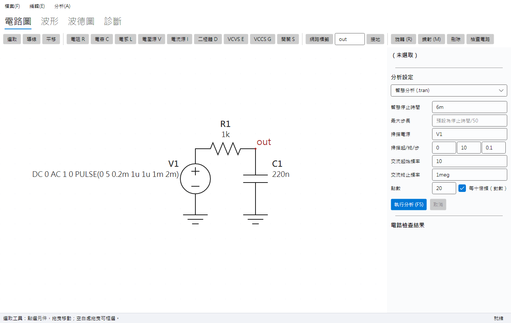
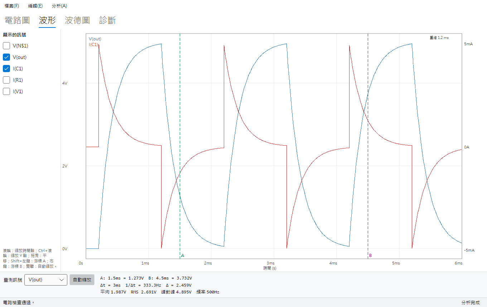
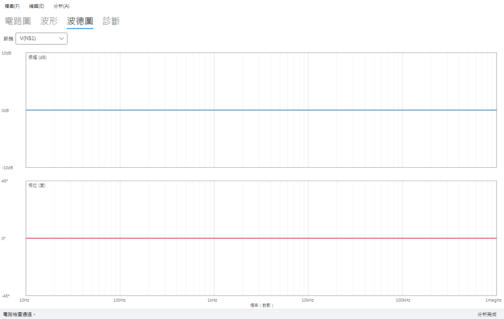
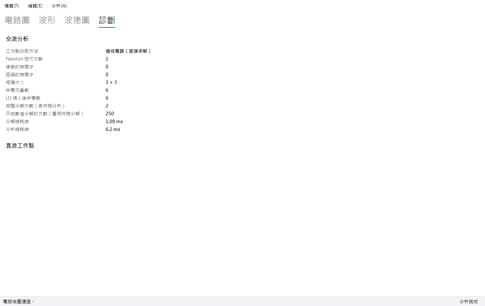

# 電路實驗台 CircuitBench

[](https://github.com/hn83320589/CircuitBench/actions/workflows/ci.yml)

CircuitBench 是離線使用的中文電路模擬桌面工具，對象是高職電子科的學生。學生可以在電腦上畫電路、量電壓、看波形；電路接錯時，程式會用中文說明哪裡出錯，並在圖上用紅框標出問題位置。

- 平台：Windows
- 技術：.NET 9、Avalonia 11（MVVM，使用 CommunityToolkit.Mvvm）
- 數值核心全部自行實作，沒有使用任何現成的數值、電路模擬或圖表套件

| 電路圖編輯器 | 波形檢視器 |
|---|---|
|  |  |
| **波德圖** | **診斷頁** |
|  |  |

> 截圖由 Avalonia Headless 測試以 Skia 實際繪製產生。設定 `CIRCUITBENCH_SCREENSHOTS=<資料夾>` 後執行 `dotnet test tests/CircuitBench.App.Headless.Tests`，就會重新產生。

---

## 功能

**電路圖編輯器**
- 在格點畫布上放置元件、拉導線（自動拆成水平與垂直兩段）、旋轉（R）、鏡射（M）、移動、刪除、複製貼上。
- 縮放（滾輪）、平移（右鍵或中鍵拖曳）、框選，所有座標都對齊格點。
- 復原與重做預設 200 層（至少 100 層）。
- 連線規則：
  - 導線端點或元件接腳落在另一條導線的中段時，自動產生接點。
  - 兩條導線只是交叉、沒有接點時，不相連。
  - 接腳與導線端點落在同一格點即相連。
  - 同名的網路標籤視為同一節點；接地固定為節點 0。
- **電路檢查**：每次分析前都會先檢查，問題以中文列出，並在圖上用紅框標示。檢查項目：
  - 沒有接地
  - 浮接節點（沒有直流路徑通到接地）
  - 只由電壓源（含受控電壓源）與電感構成的迴路
  - 未連接的接腳
  - 參數無效
  - 元件名稱重複

**元件**
- 電阻、電容、電感
- 獨立電壓源與電流源：DC、SIN、PULSE、PWL，另可設定交流分析用的振幅與相位
- 二極體（Is、n）
- 電壓控制電壓源 E、電壓控制電流源 G
- 依時間切換的理想開關
- 接地

參數接受工程記號，例如 `4.7k`、`10uF`、`1meg`。注意 `m` 一律是毫，百萬要寫 `meg`。

**分析**

| 分析 | 說明 |
|---|---|
| 直流工作點 | 收斂失敗時依序改用 gmin 步進、電源步進 |
| 直流掃描 | 掃描一個獨立電源的值 |
| 暫態分析 | 可變步長、LTE 步長控制、轉折點時間精確 |
| 交流分析 | 線性或對數掃描 |

所有分析都在背景執行，會回報進度，也可以取消；取消後不會留下只算到一半的結果。

**波形與輸出**
- 多條曲線、多個 Y 軸（電壓與電流各一軸）。
- 兩條游標，顯示 Δt、ΔV、1/Δt，以及區間內的平均值、RMS、峰對峰值與頻率。
- 波德圖：dB 與展開後的相位，對數頻率軸。
- 匯出：
  - 專案檔：JSON，附 schemaVersion
  - SPICE 子集網表：可匯入也可匯出
  - 波形：CSV（UTF-8 with BOM）或 SVG
  - 電路圖：SVG
- 每 60 秒自動儲存，當機後重新開啟會提示回復。

---

## 建置與執行

需要 [.NET SDK 9.0.x](https://dotnet.microsoft.com/download/dotnet/9.0)，目標平台為 Windows 10/11。

```powershell
git clone https://github.com/hn83320589/CircuitBench.git
cd CircuitBench
dotnet build -c Release
dotnet run --project src/CircuitBench.App -c Release

# 單元、性質、ViewModel、Headless 測試（效能測試除外）
dotnet test -c Release --filter "Category!=Performance"

# 效能測試（建議在 Release 組態、電源設為高效能時執行）
dotnet test tests/CircuitBench.Performance.Tests -c Release --filter "Category=Performance" --logger "console;verbosity=detailed"

# 產生 win-x64 單一執行檔
dotnet publish src/CircuitBench.App -c Release -r win-x64 --self-contained true -p:PublishSingleFile=true -o publish/win-x64
```

CI 流程（`.github/workflows/ci.yml`）在 `windows-latest` 上執行，使用 `setup-dotnet` 9.0.x：
1. 建置並執行全部測試。
2. 在獨立步驟執行效能測試，僅供參考，不影響綠燈。
3. 把 win-x64 發佈檔上傳為 artifact `CircuitBench-win-x64`。

**範例電路**：`samples/` 有 12 個範例，每個都有專案檔與 SPICE 網表，預期結果寫在 [samples/EXPECTED.md](samples/EXPECTED.md)，並由測試自動驗證。範例包括分壓器、RC 低通、RLC 共振、半波與全波整流、橋式整流加濾波、受控源反相放大器、開關電感、LC 振盪等。

---

## 架構

```
src/
  CircuitBench.Core            純 net9.0：模型、工程記號、檢查、MNA、稀疏 LU、分析、量測、抽樣、SPICE、CSV
  CircuitBench.Schematic       純 net9.0 → Core：圖面模型、幾何、點選、連線萃取、復原/重做、專案檔、電路圖 SVG
  CircuitBench.App.ViewModels  純 net9.0 → Core, Schematic：所有 ViewModel、服務介面、自動儲存、波形 SVG
  CircuitBench.App             Avalonia → ViewModels：View、三個自訂繪製控制項、服務實作、Composition Root
tests/
  CircuitBench.ReferenceSolver 不參考任何正式專案的稠密參考求解器
  CircuitBench.TestKit         性質測試 harness、亂數電路、Core→參考求解器的轉接、Lambert W、ManualTimeProvider
  CircuitBench.*.Tests         Core / Schematic / ViewModels / Headless / Performance
```

**相依方向**是單向的：`App → App.ViewModels → Schematic → Core`。只有 App 參考 Avalonia。

**MVVM 的分工**：
- `SchematicCanvas` 只負責兩件事：把螢幕座標轉成世界座標後呼叫 `EditorViewModel.PointerPressed/Moved/Released`，以及依 ViewModel 的狀態繪圖。工具切換、選取、拖曳、旋轉、標籤命名、檢查標示等邏輯全部在 ViewModel，因此都能直接用單元測試驗證。
- `App.axaml.cs` 是手寫的 Composition Root，沒有使用 DI 容器。

**圖面文件**（`SchematicDocument`）不可變，每次編輯都產生新文件。因此：
- 復原與重做只要保存快照即可；`ImmutableList` 會共用結構，保存 200 層的成本很低。
- 復原之後，圖面與萃取出的網表一定都回到原狀（驗收標準 19 的性質測試逐步驗證了這一點）。

**時間**：所有取得「現在時間」或量測耗時的地方，都透過 `TimeProvider`，包括自動儲存計時、分解耗時、重繪耗時。測試使用自製的 `ManualTimeProvider` 來推進時間。

### 參考求解器與正式程式碼互相獨立

參考求解器 `tests/CircuitBench.ReferenceSolver` 的設計刻意與正式程式碼分開：

- **不共用任何程式碼**：專案沒有任何 ProjectReference，有自己的電路描述型別（`RefCircuit`、`RefElement`）。
- **作法最直接**：每一次求解都重新組出**稠密** MNA 矩陣，以高斯消去（部分主元）求解；暫態只用固定步長的 BE 或 TR。
- **轉接層只做欄位對應**：TestKit 的 `CoreToReference` 把 Core 的電路逐欄位轉成 `RefCircuit`，不含任何求解邏輯。
- **本身也先驗證過**：用分壓器、RC 解析解、LC 能量守恆、Lambert W 等手算值驗證參考求解器（`ReferenceSolverSanityTests`），之後才用它來驗證正式求解器。

---

## 演算法說明

### MNA 組裝

**未知數**：
- 所有非接地節點的電壓；接地節點 0 被消去。
- 支路電流：獨立電壓源、受控電壓源（E）與電感各一個。

**元件蓋印**：

| 元件 | 蓋印方式 |
|---|---|
| R | 電導 G = 1/R 蓋在 (p,p)、(q,q)、(p,q)、(q,p) |
| 電流源（I） | 只改右側向量 |
| G | 轉導 gm 蓋在輸出列、控制欄 |
| V、E | 關聯矩陣 ±1 蓋在 (p,k)、(k,p)、(q,k)、(k,q)；E 另外在第 k 列加上 −gain × 控制電壓 |
| L | 以支路電流為未知數：直流時方程為 v(p) − v(q) = 0（短路）；暫態時為 v = L·di/dt 的伴隨模型 |
| C | 直流時開路；暫態時為 i = C·dv/dt 的伴隨模型（等效電導加等效電流源） |
| 二極體 | 在目前的 Newton 迭代值線性化成 gd 與 Ieq，並聯 gmin |
| 開關 | 電導隨時間改變的電阻（Ron 或 Roff） |

**固定結構**：各元件只在 `Register` 登記非零位置一次。直流、暫態、交流共用同一個 `SparsityPattern`，對角也一定預留給 gmin 步進。因此整個分析過程中矩陣**結構從不改變**，只有數值改變。

**伴隨模型與積分方法無關**：積分方法以係數表示：

x′(n+1) ≈ A0·x(n+1) + A1·x(n) + A2·x(n−1) + B·x′(n)

| 方法 | A0 | A1 | A2 | B |
|---|---|---|---|---|
| BE | 1/h | −1/h | 0 | 0 |
| TR | 2/h | −2/h | 0 | −1 |
| 可變步長 BDF2 | 依 h 與前一步長計算 | | | 0 |

電容與電感依這組係數組出伴隨模型，所以新增積分方法時不需要改動元件。

**支路電流的正方向**：
- 電壓源與電感：由正端流入元件為正。
- 電流源：與 SPICE 相同，電流由 n+ 經電源流到 n−。
- 其他兩端元件：由第一個接腳流向第二個接腳為正。

### 稀疏 LU 與符號分解重用

實作在 `Core/LinearAlgebra/SparseLu.cs`，是泛型的左看式 Gilbert–Peierls 分解，實數（`double`）與複數（`System.Numerics.Complex`）共用同一份程式碼。

1. **欄排序**：在 A+Aᵀ 的結構上做最小度排序（明確建出消去圖），只在第一次分解時計算一次。以 100×100 網格為例，填入後的非零元素約 39 萬個，遠少於不排序時的帶狀填入。
2. **完整分解（`Factor`）**：每一欄先從 A 的非零列出發，沿 L 的圖做 DFS，得到需要更新的步驟，再依拓樸順序做稀疏三角求解。主元採門檻式部分主元選擇（門檻 0.1），對角元素夠大時優先選對角。L 與 U 的結構，以及計算時的拓樸順序，都會保存下來。
3. **只重做數值（`Refactor`）**：結構不變時，直接沿用主元順序與 L/U 結構，只重新計算數值。如果某個主元相對於同欄其他候選值小於門檻（數值上不再適合），會自動退回完整分解，並記錄在統計資料中。
4. **奇異偵測（兩道防線）**
   - **分解時**：組裝矩陣時，為每個元素記錄所有蓋印值絕對值的最大者，也就是抵消前的量級。主元判定的尺度取「該欄元素抵消前的量級」與「消去過程中出現的最大更新量」兩者較大者；最大候選主元 ≤ 1e-13 × 尺度即視為奇異。這樣才能偵測**同一個元素內的抵消**。例如受控源的負電導 −1/3k 剛好抵消 3 kΩ 電阻：只看抵消後的殘值當尺度的話，判定永遠不會成立。`Refactor` 也套用同一個判定。
   - **求解後**：計算列縮放後的條件數下界 κ(D·A) ≥ ‖x‖∞ / maxᵢ(|bᵢ| / rᵢ)，rᵢ 是第 i 列抵消前的最大量級。超過 1e12 時解只剩約 3 位有效數字，視為接近奇異。列縮放讓「電流灌進只經 Roff 接地的節點、得到 1e6 V」這類量級懸殊但正確的解不被誤判。
   - 兩者都轉成中文訊息，指出無法決定的節點電壓或支路電流、相關元件，以及可能原因（浮接節點、電壓源迴路、負電阻剛好抵消）。

暫態每一步、Newton 每一次迭代、交流每一個頻率點，都只做 `Refactor`。診斷頁會顯示完整分解與只做數值分解各幾次。

### 收斂策略（直流工作點）

1. **Newton–Raphson**：每個未知數的變化都小於 reltol·|值| + 絕對容許值（電壓用 vntol，電流用 abstol），而且沒有任何二極體在這次迭代中被限制，才算收斂。每次最多 100 次迭代。
2. **接面電壓限制**：二極體以 pnjlim 限制每次迭代的接面電壓變化，避免 exp 溢位與振盪；超過 80·nVt 的部分改用切線延伸。
3. **gmin 步進**：每個節點的對角先加 1e-2，每次除以 10，直到降到設定的 gmin，每一步都以前一步的解當初值。某一步失敗時，退回上一個成功的 gmin，並把倍率開根號後再試。
4. **電源步進**：所有獨立電源乘以比例 0 → 1，失敗時把增量減半。
5. 全部失敗時丟出 `ConvergenceException`，訊息會指出最後未收斂的未知數，例如「節點 N3 的電壓」。
6. 工作點收斂後**再做一次 Newton 迭代**。Newton 是二次收斂，多做一次可讓工作點的精度遠優於 reltol，例如二極體電流與 Lambert W 解析解的誤差小於 1e-6。

實際採用的方法記錄在 `SolverStatistics.Method`，診斷頁會顯示。

### 暫態積分與步長控制

實作在 `Core/Analysis/TransientEngine.cs`。

- **起點**：電源取波形在 t = 0 的值，求一次直流工作點。
- **積分方法：混合使用 BE、BDF2、TR**
  - 平常用 TR。TR 用在線性 LC 時等同隱式中點法，能量守恆，所以 LC 振盪 100 個週期的能量漂移遠小於 1%。
  - 缺點：TR 遇到剛性模態（例如理想開關以 Roff = 1 TΩ 切斷電感電流）時，會逐步正負交替。因此在 t = 0 與每個轉折點之後，改用以下流程：
    1. 先走兩步 BE。
    2. 再用可變步長的 BDF2；BDF2 是 L-stable，剛性模態會被衰減而不會交替。
    3. 等步長穩定（成長率低於 1.25，或已達最大步長）才切回 TR。
  - 剛性也可能在**非轉折點**出現，例如飛輪二極體在電流降到 0 時截止，該節點瞬間變成極高阻抗。處理方式：
    - 某個未知數在 TR 的這一步反向時，用 BDF2 重算同一步。
    - 在反向的未知數上，兩者相差超過容許值 10 倍，就判定為 TR 振盪：改用 BDF2 的結果，並回到 BDF2 階段。
    - 正常的極值處（例如 LC 振盪的峰值），TR 與 BDF2 只差 LTE 等級，所以會保留 TR 的結果，不會損失能量。
- **局部截斷誤差（LTE）**
  - 以狀態量（電容電壓、電感電流）的除差估計三階導數：TR 的 LTE ≈ h³x‴/12，BDF2 ≈ 2h³x‴/9，BE 則以二階除差估計。
  - 容許值 = trtol·(reltol·局部尺度 + vntol 或 abstol)，局部尺度取最近幾點的最大絕對值。
  - 誤差比大於 1 就拒絕這一步，新步長 h·max(0.25, 0.9·r^(−1/3))；接受時步長最多放大到 2 倍，且不超過最大步長。
  - **被拒絕的步驟不呼叫 `AcceptTransient`**：元件歷史不變，也不寫入結果。Newton 不收斂時，步長縮為 1/8 重試。
- **轉折點**
  - PULSE 的四個轉折時刻、PWL 的每一點、SIN 的延遲、開關切換時刻，都收集成排序好的佇列。
  - 下一步會跨過轉折點時，把步長截短，並**直接把時間設成轉折點的數值本身**（不是 t+h 算出來的近似值），所以時間誤差為 0。
  - 為避免留下極短的步長，若剩下的距離小於 0.25h，就把剩下的距離平分成兩步。
  - **左極限**：落在轉折點上的那一步，以 `Math.BitDecrement(t)` 求值，也就是切換前的狀態；下一步才使用切換後的狀態。這樣開關切換、零上升時間的 PULSE 都有明確定義。
- **讓預設設定也準確的三道步長限制**：LTE 控制的是每一步的局部誤差，不是長時間累積的相位誤差，也管不到純電阻電路（沒有狀態量，LTE 恆為 0）。因此另外加了三道限制：
  1. **SIN 電源**：步長上限自動設為週期的 1/50。
  2. **自由振盪**：追蹤每個狀態量的相鄰極值，以相鄰極值的間隔估計半週期。擺動遠大於容許值時，把步長上限設為估計週期的 1/100，因為 TR 的頻率誤差約 (ωh)²/12、衰減率誤差約 (ωh)²/4，要達到 0.2% 需要每週期約 100 步。超過 4 個半週期沒有新極值就解除，振盪衰減後不再浪費點數。
  3. **折線內插誤差**：結果會以折線顯示與量測，所以用所有未知數的二階除差估計每段折線與真實波形的差（≈ h²|x″|/8）；超過 trtol·(reltol·|x| + vntol) 就拒絕這一步並縮小步長。這涵蓋了二極體轉折處這類沒有狀態量的急彎。
- **預設設定下的效果**（修改前 → 修改後）：
  - 欠阻尼 RLC：頻率誤差 0.46% → 0.033%，衰減率誤差 1.37% → 0.098%。
  - 半波整流畫出的折線與真實波形：1.31% → 0.08% 峰值。
  - LC 振盪：每週期 33 點 → 100 點。
  - RC 步階：91 點 → 108 點，幾乎不變。
- trtol 預設為 **1**（SPICE 為 7），以換取準確度。

### 交流分析

先求直流工作點，再在工作點把非線性元件線性化，例如二極體的 gd = Is/(nVt)·e^(Vd/nVt) + gmin。接著蓋印複數導納（電容 jωC、電感 −jωL）。各頻率點共用同一個複數 LU，只做 `Refactor`。

### 波形抽樣與量測

- **`MinMaxPyramid`**：每條訊號建一次最小/最大值金字塔，第 k 層每個元素涵蓋 2^k 個取樣點。查詢任意索引區間的最小/最大值是 O(log N)，所以一次重繪是 O(W·log N)，W 是像素寬度。每一欄的結果都等於暴力計算的真實最小與最大值，所以任何縮放都不會遺漏尖峰。
- **繪製**：每欄畫一條 min–max 垂直線，並依上一點的位置決定先畫上端或下端，避免在邊緣產生假尖刺。
- **量測**：資料視為分段線性。平均值用梯形積分；RMS 用 ∫(線性)² = h(a² + ab + b²)/3 的精確積分，因此在非均勻時間點上也正確。頻率取「減去平均值後的上升零交越」，交越時間以線性內插求得。游標讀值也以內插計算。
- **相位展開**：相鄰兩點的相位差保持在 ±180° 以內，避免 ±180° 的折返跳動。

---

## 效能

**量測環境**：

| 項目 | 規格 |
|---|---|
| CPU | Intel Core i7-13700 |
| RAM | 32 GB |
| 作業系統 | Windows 11 |
| .NET SDK | 9.0.315 |
| 組態 | Release |

每項先暖機一次，再取第二次的數據（`tests/CircuitBench.Performance.Tests`）。

| 項目 | 門檻 | 實測 | 備註 |
|---|---|---|---|
| 2,000 節點 RC 梯形網路，暫態 10,000 步 | ≤ 10 s | **約 3.0 s** | 10,069 個接受步、2 個拒絕步；只做數值分解 10,071 次 |
| 100 × 100 電阻網格（1 萬個未知數），直流工作點 | ≤ 1 s | **約 0.31 s** | 非零 49,597 個，填入後 393,318 個 |
| 2,000 節點電路，500 個頻率點的交流分析 | ≤ 3 s | **約 0.22 s** | 複數 LU 只做一次完整分解 |
| 100 萬點 × 2 條曲線、寬 1,920 px，縮放與平移的抽樣與刻度計算 | — | 平均 0.9 ms，最差 2.6 ms | 只量 ViewModel 部分（`Performance.Tests`） |
| **100 萬點 × 2 條曲線，Skia 完整重繪**（WaveformCanvas 1750×899，縮放與平移 100 次） | ≤ 16 ms | **平均約 5 ms，最差 10–15 ms**（連續 5 次執行皆通過） | `App.Headless.Tests` 的 `RenderPerformanceTests`：以 `RenderTargetBitmap` 讓 Skia 實際光柵化，涵蓋錄製、幾何建構與光柵化。整個視窗的 `CaptureRenderedFrame`（含版面配置與讀回 8 MB 點陣圖）最差約 16 ms，僅供參考 |

Skia 完整重繪的數據來自 Headless 的 CPU 光柵化。實際執行程式時，Avalonia 預設使用 GPU 繪製，通常更快。

重繪最差值的主要來源是縮放到新範圍時刻度文字要重新排版，以及大範圍時每欄的長垂直線要光柵化。同一畫面重複重繪只要約 3 ms。

GitHub Actions 的 runner 效能浮動很大，因此 CI 雖然會執行效能測試（含 Skia 重繪），但設為 `continue-on-error`；正式數據以上表為準。

---

## 測試

`dotnet test --filter "Category!=Performance"` 共執行 **344** 個測試案例，全數通過；另有 5 個效能測試：

| 專案 | 數量 | 內容 |
|---|---|---|
| Core.Tests | 216 | 工程記號、波形、稀疏 LU、MNA/工作點、非線性、直流掃描、暫態、交流、取消、檢查、抽樣、量測、波德圖、CSV、SPICE |
| Schematic.Tests | 60 | 連線萃取、旋轉鏡射、復原重做、點選框選、自動排列、SVG、專案檔 |
| App.ViewModels.Tests | 63 | 編輯器、分析執行、波形與波德圖、診斷、自動儲存、檔案操作、12 個範例 × 2 |
| App.Headless.Tests | 5 | 開啟主視窗、工具列與畫布點擊、鍵盤旋轉、屬性面板、執行分析後切頁並繪製波形 |

**性質測試**有 15 組以上，都以固定種子產生隨機輸入：

- 實數與複數稀疏 LU 對照稠密解；300 個秩虧矩陣全部偵測為奇異、200 個良態矩陣不誤報
- 符號分解重用（Refactor）與重新分解結果相同
- 300 組隨機線性電路的直流工作點、200 組的交流分析，與參考求解器比對
- 暫態步長控制的各項性質
- 最小最大抽樣，以及區間最小/最大值
- 平均值與 RMS 的積分、零交越頻率
- 復原 120 層
- SPICE 往返、自動排列往返、專案檔往返
- 任意時間點取消

失敗時會印出可重現的種子，例如 `CIRCUITBENCH_SEED=20261106`。設定這個環境變數後重跑，只會執行那一組輸入。

---

## 設計取捨

- **TR + BE/BDF2 混合，而不是單用 TR-BDF2 或 BDF2**：L-stable 的方法在 LC 振盪中每一步都會損失能量，以 ωh = 0.2 計，BDF2 每步約 0.07%，100 個週期就會遠超過 1%。TR 能量守恆，但遇到剛性模態會交替。混合策略在轉折點與偵測到交替時用 L-stable 的方法，其餘時間用 TR，同時滿足驗收標準 8～12。
- **把圖面文件設計成不可變**：復原與重做只要保存快照，「復原後網表必然相同」也就天然成立。代價是每次編輯都會配置新的清單；不過 `ImmutableList` 共用結構，對教學規模的電路來說成本可忽略。
- **接腳碰到導線中段也算相連**：與導線端點的規則一致，學生比較不會困惑。代價是元件畫在導線上時會被短路，這種情況在圖上會看到接點。
- **節點上限只在 UI 端強制**：編輯器與網表匯入限制 5,000 個節點；Core 本身不設上限，所以 1 萬個節點的效能測試直接呼叫 Core。
- **SourceSpec 採用 SPICE 語意**：沒有暫態函數時，暫態沿用直流值；沒有直流值時，直流工作點取波形在 t = 0 的值。這樣網表匯出再匯入後能完全相同。
- **參數保存為字串**：保留學生輸入的 `4.7k`，萃取網表時才解析；參數錯誤會在檢查時指出是哪個元件。
- **不使用 DI 容器與 FsCheck**：Composition Root 只有十幾行。性質測試的 harness 自己寫，比較容易做到「固定種子、失敗時印出種子」，也避免引入額外的套件。
- **trtol 預設為 1**：比 SPICE 的 7 嚴格，暫態點數約多一倍，但 RC 步階響應與整流波形的誤差能穩定落在驗收門檻內。
- **預設就限制振盪與驅動訊號的步長**：代價是點數增加，例如半波整流 2 個週期從 60 點增為約 760 點、LC 每週期 100 點。這對教學規模的電路仍然只要幾十毫秒，換來學生用預設值就能看到準確、平滑的波形。
- **波形曲線不做反鋸齒**：每個像素欄本來就是一條垂直線段，反鋸齒的畫質差異很小，卻佔了大部分光柵化時間。關掉後，完整重繪的平均時間從 12 ms 降到約 5 ms。

## 已知限制

- **二極體沒有接面電容與崩潰**：模型就是需求規格中的 Shockley 方程式加上 gmin，因此反向恢復、齊納崩潰都無法模擬。
- **開關是理想的時間控制開關**：切換只依時間清單決定，不能由電壓或電流控制。
- **自由振盪的第一個週期不受步長限制**：要看到兩個極值才能估計週期，所以第一個週期只受 LTE 與折線誤差控制。多週期的頻率與衰減率量測不受影響，但極短（不到一個週期）的模擬，精度仍取決於 LTE 與最大步長。
- **奇異判定是數值門檻**：條件數下界超過 1e12 才判定為接近奇異。條件極差但還沒到這個程度的電路仍會求解，只是有效位數較少。
- **導線只允許水平或垂直**：移動元件時，連著的導線不會跟著拉伸（沒有 rubber-band），要另外移動。
- **自動排列只是格狀排列**：匯入的網表沒有圖面座標，所以元件排成格狀，各接腳以網路標籤相連；萃取出的網表會正確，但圖面不美觀，需要手動整理。
- **SPICE 子集只支援規格列出的語法**：沒有子電路（`.subckt`）、參數（`.param`），也沒有 `.title` 以外的控制指令。另外，第一行**不會**被當成標題行。
- **只在 Windows 上驗證過**：Avalonia 本身可以跨平台，但字型預設為 Microsoft JhengHei，也只在 Windows 上測試過。
- **Skia 重繪的量測是 CPU 光柵化**：Headless 沒有 GPU，實機的 GPU 繪製時間沒有自動化量測，只會顯示在波形頁右上角。最差值約 10–15 ms，距離 16 ms 的門檻不大，在較慢的機器上可能超過。
