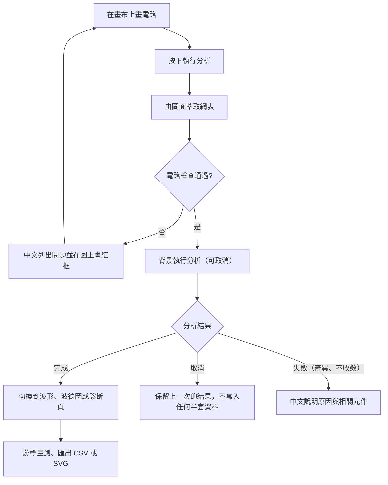
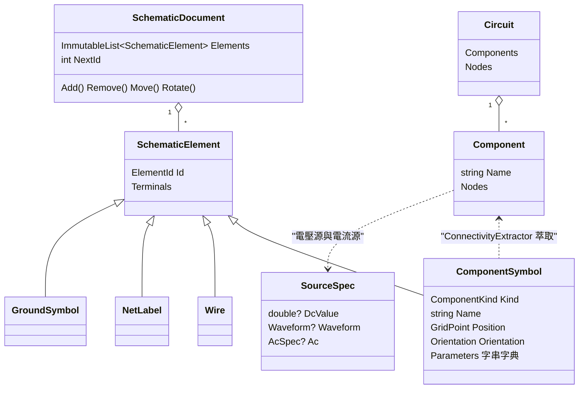
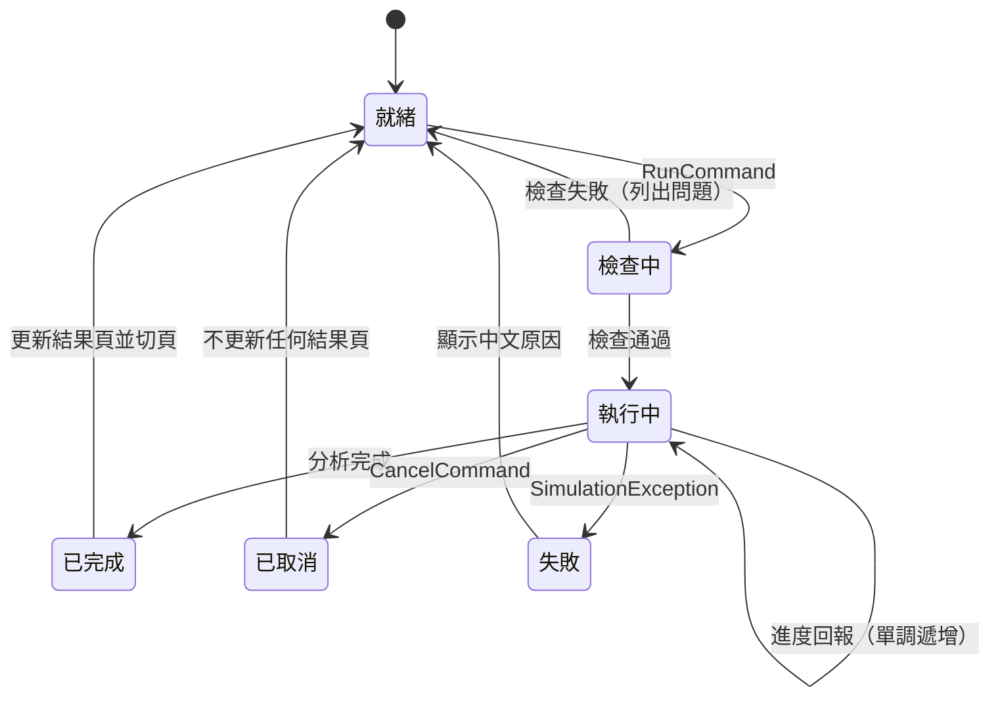

# 02 系統分析

本章說明「學生畫電路、看結果」這件事，怎麼被拆成系統行為。

## 主要業務流程

這張圖的重點是：**電路檢查擋在每一次分析之前**，而且檢查與分析的失敗訊息都會回到圖上。

## 核心使用情境

### 情境一：畫一個 RC 低通並看暫態波形

- **前置條件**：程式已開啟，畫布是空的或已有電路。
- **主要步驟**
  1. 從工具列選擇電壓源、電阻、電容、接地，點畫布放置。元件名稱自動配發為 V1、R1、C1。
  2. 用導線工具拖曳連線；斜向拖曳會自動拆成 L 形的兩段。
  3. 在屬性面板輸入 `1k`、`100n`，電源設為 `PULSE(0 5 0 1u 1u 1m 2m)`。
  4. 分析設定選「暫態」、停止時間 `10m`，按執行。
  5. 程式切到波形頁，自動加入曲線；學生拖曳兩條游標讀 Δt 與平均值。
- **例外情況**
  - 忘了放接地：檢查失敗，訊息「電路沒有接地…」，所有元件都被標成相關元件。
  - 參數打成 `1kk`：工程記號解析失敗，訊息指出元件名稱與錯誤位置。
  - 分析太久，學生按取消：狀態列顯示「已取消（未保留任何結果）」，波形頁仍是上一次的結果。

### 情境二：電路接錯，系統指出哪裡錯

- **前置條件**：學生畫了一個電容和電阻串聯的節點，但該節點只經電容接地。
- **主要步驟**
  1. 按執行，`EditorViewModel.RunCheck()` 呼叫 `CircuitValidator.Validate()`。
  2. 浮接節點檢查只用「直流路徑」建 union-find，發現該節點與節點 0 不在同一集合。
  3. 回傳 `CircuitIssue(FloatingNode, …)`，帶出節點名稱與相連的元件。
  4. `EditorViewModel` 把問題換算成世界座標上的外框（`IssueMarker`），`SchematicCanvas` 畫紅框。
- **例外情況**：如果檢查通過，但矩陣在數值上仍然奇異（例如負電阻剛好抵消電導），分析會丟出 `SimulationException`，訊息同樣指出節點與相關元件。這是第二道防線，見 08 章。

### 情境三：老師準備的 SPICE 網表匯入

- **前置條件**：老師有一份 `.cir` 檔。
- **主要步驟**
  1. 選「匯入網表」，`SpiceNetlistReader.Parse()` 逐行解析；`+` 開頭的行接到上一行。
  2. 解析成功後，`AutoLayout.FromCircuit()` 把元件排成格狀，各接腳以網路標籤相連。
  3. 網表中的 `.tran`、`.ac` 等指令轉成分析設定。
- **例外情況**：語法錯誤時回傳每一行的錯誤（行號以實體行為準，接續行回報起始行），不會載入半個電路。

## 領域模型

系統有兩套模型：**圖面模型**（有座標，給人編輯）與**電路模型**（只有連接關係，給求解器用）。連線萃取是兩者之間的橋。

要注意的設計：

- **`ComponentSymbol.Parameters` 存字串**（例如 `"4.7k"`），萃取網表時才解析成 `double`。這樣保留了學生輸入的寫法，解析錯誤也能在檢查時指出是哪個元件（📄 README「設計取捨」）。
- **兩套模型都是不可變的 record**：`SchematicDocument` 每次編輯都回傳新物件，`Circuit` 也是建立後不再改變。可變狀態只存在於求解器內部（`Device` 的暫態歷史）。

## 分析執行的狀態

`AnalysisViewModel` 的 `IsRunning`、`Status` 與結果頁之間有明確的狀態轉換。重點在「取消」與「失敗」都不會進入「更新結果頁」。

## 需求追溯表

| 需求 | 實作位置 |
|---|---|
| FR-01 編輯操作 | `src/CircuitBench.App.ViewModels/Editor/EditorViewModel.cs`、`src/CircuitBench.Schematic/Model/SchematicDocument.cs` |
| FR-02、FR-03 連線萃取 | `src/CircuitBench.Schematic/Connectivity/ConnectivityExtractor.cs`、`src/CircuitBench.Schematic/Connectivity/ComponentFactory.cs` |
| FR-04 復原重做 | `src/CircuitBench.Schematic/Editing/UndoHistory.cs` |
| FR-04 點選與框選 | `src/CircuitBench.Schematic/Editing/HitTester.cs`、`src/CircuitBench.App.ViewModels/Editor/Viewport.cs` |
| FR-05 元件模型 | `src/CircuitBench.Core/Model/Components.cs`、`src/CircuitBench.Core/Model/Waveforms.cs`、`src/CircuitBench.Core/Mna/Devices/` |
| FR-06 工程記號 | `src/CircuitBench.Core/Units/EngineeringNotation.cs` |
| FR-07、FR-08 電路檢查 | `src/CircuitBench.Core/Validation/CircuitValidator.cs` |
| FR-09 直流工作點 | `src/CircuitBench.Core/Analysis/DcSolver.cs`、`src/CircuitBench.Core/Mna/MnaSystem.cs` |
| FR-10、FR-12 直流掃描與交流 | `src/CircuitBench.Core/Analysis/Simulator.cs` |
| FR-11 暫態 | `src/CircuitBench.Core/Analysis/TransientEngine.cs` |
| FR-13 背景、取消、進度 | `src/CircuitBench.Core/Analysis/Simulator.cs`、`src/CircuitBench.Core/Analysis/MonotonicProgress.cs`、`src/CircuitBench.App.ViewModels/Analysis/AnalysisViewModel.cs` |
| FR-14 稀疏 LU | `src/CircuitBench.Core/LinearAlgebra/SparseLu.cs`、`src/CircuitBench.Core/LinearAlgebra/MinimumDegreeOrdering.cs` |
| FR-15、FR-16 波形檢視 | `src/CircuitBench.App.ViewModels/Results/WaveformViewModel.cs`、`src/CircuitBench.Core/Sampling/MinMaxPyramid.cs`、`src/CircuitBench.App/Controls/WaveformCanvas.cs` |
| FR-17 量測 | `src/CircuitBench.Core/Measurement/Measurements.cs` |
| FR-18 波德圖 | `src/CircuitBench.Core/Bode/BodeMath.cs`、`src/CircuitBench.App.ViewModels/Results/BodeViewModel.cs` |
| FR-19 專案檔與自動儲存 | `src/CircuitBench.Schematic/Persistence/ProjectSerializer.cs`、`src/CircuitBench.App.ViewModels/Services/AutoSaveService.cs` |
| FR-20 匯入匯出 | `src/CircuitBench.Core/IO/`、`src/CircuitBench.Schematic/Export/SchematicSvgExporter.cs`、`src/CircuitBench.App.ViewModels/Results/WaveformSvgExporter.cs` |
| FR-21 診斷頁 | `src/CircuitBench.App.ViewModels/Results/DiagnosticsViewModel.cs` |
| NFR-01 效能 | `tests/CircuitBench.Performance.Tests/PerformanceTests.cs`、`tests/CircuitBench.App.Headless.Tests/RenderPerformanceTests.cs` |
