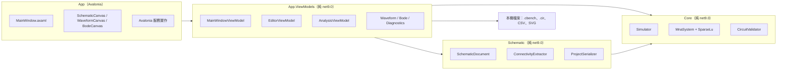
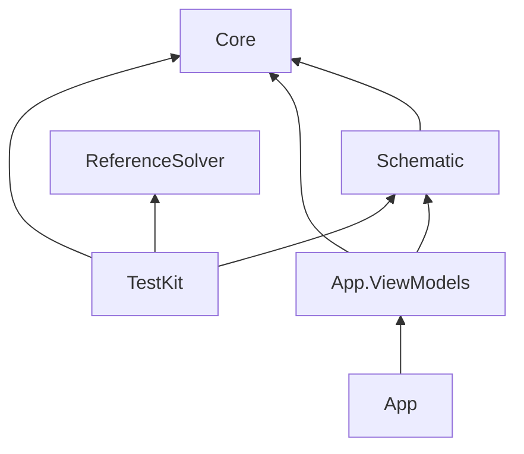

# 03 架構設計

## 整體架構

這張圖要看兩件事：**相依方向是單向的**，以及**只有 App 認識 Avalonia**。



外部只有本機檔案系統，沒有資料庫、網路服務或第三方 API（📄 需求規格「不得呼叫外部網路服務」）。

## 分層與職責

| 專案 | 職責 | 不能做的事 |
|---|---|---|
| `CircuitBench.Core` | 電路模型、工程記號、電路檢查、MNA、稀疏 LU、四種分析、量測、抽樣、波德圖數學、SPICE 讀寫、CSV | 不知道圖面座標，不參考 UI |
| `CircuitBench.Schematic` | 圖面模型、幾何與方向、點選、連線萃取、復原重做、專案檔、電路圖 SVG、自動排列 | 不參考 UI；不做數值計算 |
| `CircuitBench.App.ViewModels` | 所有 ViewModel、服務介面（檔案對話框、訊息框、路徑）、自動儲存、波形 SVG | 不參考 Avalonia；不直接開對話框 |
| `CircuitBench.App` | XAML、三個自訂繪製控制項、服務的 Avalonia 實作、Composition Root | 不放業務邏輯 |

📄 依據：分層由需求規格指定（「Core：純 net9.0，不引用 UI…」）。把 ViewModel 獨立成專案也是規格要求，目的是讓 ViewModel 的測試不需要啟動 Avalonia。

## 目錄結構導覽

```
src/
├── CircuitBench.Core/
│   ├── Model/            Circuit、Component（record）、SourceSpec、Waveform 與轉折點
│   ├── Units/            工程記號解析與格式化
│   ├── Validation/       分析前的電路檢查（union-find）
│   ├── LinearAlgebra/    SparsityPattern、SparseLu、MinimumDegreeOrdering
│   ├── Mna/              MnaLayout（未知數排列）、MnaSystem、LoadContext、Devices/
│   ├── Analysis/         Simulator（入口）、DcSolver、TransientEngine、MonotonicProgress
│   ├── Measurement/      平均、RMS、峰對峰、零交越頻率、內插
│   ├── Sampling/         MinMaxPyramid
│   ├── Bode/             dB、相位展開、對數刻度
│   └── IO/               SPICE 讀寫、CSV
├── CircuitBench.Schematic/
│   ├── Geometry/         GridPoint、WorldPoint、Orientation
│   ├── Model/            SchematicDocument、元素、ComponentCatalog、符號幾何
│   ├── Connectivity/     圖面 → Circuit
│   ├── Editing/          UndoHistory、HitTester、AutoLayout
│   ├── Persistence/      ProjectFile、ProjectSerializer（JSON + schemaVersion）
│   └── Export/           電路圖 SVG
├── CircuitBench.App.ViewModels/
│   ├── Editor/           EditorViewModel、PropertyPanelViewModel、Viewport
│   ├── Analysis/         分析設定與執行
│   ├── Results/          波形、波德圖、診斷、波形 SVG
│   └── Services/         服務介面、AutoSaveService
└── CircuitBench.App/
    ├── Views/            MainWindow
    ├── Controls/         SchematicCanvas、WaveformCanvas、BodeCanvas（覆寫 Render）
    └── Services/         Avalonia 版的對話框與路徑服務
tests/
├── CircuitBench.ReferenceSolver/   稠密 MNA 參考求解器（零專案參考）
├── CircuitBench.TestKit/           性質測試 harness、亂數電路、轉接層、ManualTimeProvider
└── CircuitBench.*.Tests/           Core、Schematic、ViewModels、Headless、Performance
samples/                            12 組範例（.cbench + .cir）與 EXPECTED.md
```

## 模組相依關係

專案層級的參考（以各 csproj 檔為準）：



- 沒有循環相依。
- `ReferenceSolver` 刻意不參考任何正式專案（`tests/CircuitBench.ReferenceSolver/CircuitBench.ReferenceSolver.csproj` 裡有註解說明）。Core 的電路要轉給參考求解器時，由 `tests/CircuitBench.TestKit/CoreToReference.cs` 逐欄位對應。這樣參考解才不會「跟著正式程式碼一起錯」。

## 使用到的設計模式

### MVVM：畫布只做座標轉換與繪圖

`SchematicCanvas` 只做兩件事：把螢幕座標轉成世界座標後呼叫 `EditorViewModel.PointerPressed/PointerMoved/PointerReleased`，以及依 ViewModel 的狀態繪圖。工具切換、選取、拖曳、旋轉、標籤命名、檢查標示等邏輯全部放在 ViewModel。

- **為什麼**：驗收標準 23 要求這些行為都有 ViewModel 測試（📄 需求規格）。邏輯放在 VM，測試直接呼叫 `PointerPressed(new WorldPoint(…))` 就能驗證，不需要模擬滑鼠事件。
- **不這樣做會怎樣**：邏輯寫在 code-behind 時，只能靠 Headless 測試覆蓋。Headless 測試慢，而且很難精確控制拖曳過程。

### 不可變文件 + 快照式復原

`SchematicDocument` 是 `record`，內含 `ImmutableList<SchematicElement>`。每個編輯操作都回傳新文件，`UndoHistory<T>` 只要保存舊快照。

- **為什麼**：「每一步復原後，圖面與萃取出的網表都回到該步之前的狀態」（驗收標準 19）在這個設計下天然成立，因為網表是文件的純函數（📄 README「設計取捨」）。
- **代價**：每次編輯配置新清單。`ImmutableList` 會共用結構，對教學規模的電路來說成本可以忽略。
- **替代方案**：命令模式（Command Pattern），每個操作實作 `Do/Undo`。這種做法比較省記憶體，但每種操作都要寫對反向操作，而且很難證明 100 層之後網表一定相同。

### 元件多型與「結構只登記一次」

`Device`（`src/CircuitBench.Core/Mna/Devices/Device.cs`）是抽象基底，每種元件實作：

- `Register`：登記非零位置。
- `Bind`：查出自己在 CSC 陣列中的槽位。
- `Load`：蓋印實數值。
- `LoadAc`：蓋印複數值。
- `AcceptTransient`：更新暫態歷史。

`MnaSystem` 建構時呼叫一次 `Register` 與 `Bind`，之後每次組裝都直接寫入槽位，不再查表。

- **為什麼**：直流、暫態、交流共用同一個 `SparsityPattern`，稀疏 LU 的符號分解就能一直重用（需求 FR-14）。
- 積分方法以 `IntegrationCoefficients(A0, A1, A2, B)` 傳給元件，所以新增積分方法時不需要改動元件，見 07 章。

### 服務介面 + 手寫 Composition Root

ViewModel 透過以下介面存取外部世界：

- `IFileDialogService`
- `IMessageService`
- `IAppPaths`
- `ISimulator`

`src/CircuitBench.App/App.axaml.cs` 的 `CreateMainViewModel()` 手動 new 出所有物件，大約十行。

- 📄 依據：規劃文件決定「不引入 DI container」；README 說明「Composition Root 只有十幾行」。
- 測試中則用 `NullDialogs`（在 `src/CircuitBench.App.ViewModels/Services/Services.cs`）與 `ManualTimeProvider` 取代。

## 橫切關注點

| 關注點 | 做法 | 位置 |
|---|---|---|
| 錯誤處理 | 使用者可見的錯誤一律是 `SimulationException`（中文訊息）或 `CircuitIssue`；ViewModel 捕捉後顯示在狀態列。取消使用 `OperationCanceledException`，與失敗分開處理 | `src/CircuitBench.Core/Mna/MnaSystem.cs`、`src/CircuitBench.App.ViewModels/Analysis/AnalysisViewModel.cs` |
| 不崩潰的載入 | `ProjectSerializer.Deserialize()` 回傳 `ProjectLoadResult`（Ok／TooNew／Corrupted），不把例外丟到 UI | `src/CircuitBench.Schematic/Persistence/ProjectSerializer.cs` |
| 時間 | 所有「現在時間」與耗時量測都透過 `TimeProvider`（自動儲存計時、分解耗時、重繪耗時） | 📄 需求規格；`Simulator`、`SparseLu`、`AutoSaveService` 的建構子都接受 `TimeProvider` |
| 設定 | 沒有設定檔。數值設定存在專案檔的 `AnalysisSettings`；路徑由 `IAppPaths` 提供 | `src/CircuitBench.Schematic/Persistence/ProjectFile.cs` |
| 執行緒 | 分析以 `Task.Run` 在背景執行；`Progress<T>` 在建立它的 UI 執行緒上回呼 | `src/CircuitBench.Core/Analysis/Simulator.cs` |
| 日誌 | 沒有日誌框架。診斷資訊以 `SolverStatistics` 結構化回傳，顯示在診斷頁 | `src/CircuitBench.Core/Analysis/AnalysisTypes.cs` |
| 建置品質 | `Directory.Build.props` 開啟 `TreatWarningsAsErrors`、`Nullable`、`AnalysisLevel=latest`；`Directory.Packages.props` 集中管理套件版本 | 根目錄 |
