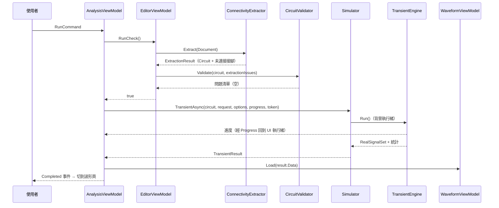
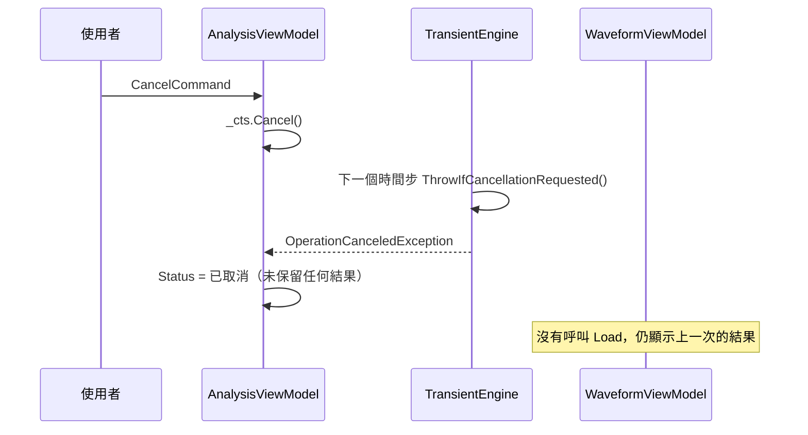
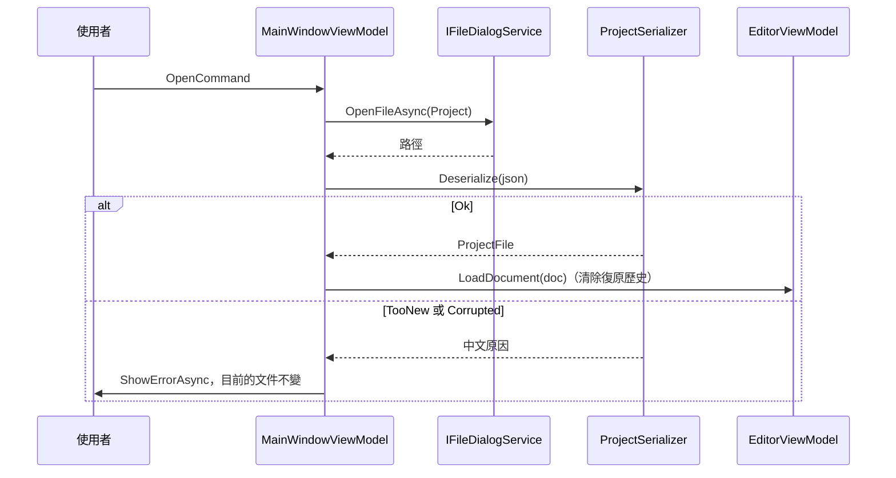
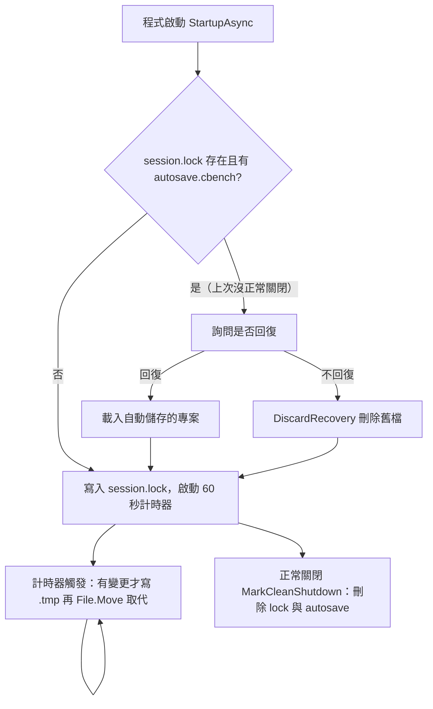

# 06 輸入輸出介面與資料流

本專案是桌面程式，沒有 HTTP API。本章改寫三件事：

1. 程式讀寫的檔案格式。
2. Core 對外提供的分析 API。
3. 三條核心流程的資料流。

本專案也沒有資料庫，原本 05 章的內容（資料怎麼存）併入本章的「專案檔」一節。

## 檔案格式

| 檔案 | 方向 | 格式 | 讀寫位置 |
|---|---|---|---|
| `*.cbench` 專案檔 | 讀／寫 | JSON，含 `schemaVersion` | `src/CircuitBench.Schematic/Persistence/ProjectSerializer.cs` |
| `autosave.cbench`、session.lock | 讀／寫 | 同上；lock 只寫時間戳 | `src/CircuitBench.App.ViewModels/Services/AutoSaveService.cs` |
| `*.cir` SPICE 子集網表 | 讀／寫 | 純文字，每行一個元件 | `src/CircuitBench.Core/IO/SpiceNetlistReader.cs`、`src/CircuitBench.Core/IO/SpiceNetlistWriter.cs` |
| 波形 CSV | 寫 | UTF-8 with BOM、InvariantCulture | `src/CircuitBench.Core/IO/CsvExporter.cs` |
| 波形 SVG | 寫 | SVG | `src/CircuitBench.App.ViewModels/Results/WaveformSvgExporter.cs` |
| 電路圖 SVG | 寫 | SVG | `src/CircuitBench.Schematic/Export/SchematicSvgExporter.cs` |

預設路徑由 `IAppPaths` 提供（📄 需求規格「其他」）：

- 專案檔：`%UserProfile%\Documents\CircuitBench\`
- 設定與自動儲存：`%LocalAppData%\CircuitBench\`

### 專案檔

節錄自 `samples/02-rc-lowpass.cbench`：

```json
{
  "schemaVersion": 1,
  "title": "RC 低通濾波器",
  "nextId": 8,
  "elements": [
    { "type": "component", "id": 2, "kind": "resistor", "name": "R1",
      "x": 2, "y": 2, "rotation": 0, "mirrored": false,
      "parameters": { "value": "1k" } },
    { "type": "label", "id": 5, "name": "out", "x": 4, "y": 2, "rotation": 0, "mirrored": false },
    { "type": "ground", "id": 6, "x": 0, "y": 6, "rotation": 0, "mirrored": false }
  ],
  "analysis": { "kind": "ac", "dcSource": "V1" }
}
```

設計重點：

- **參數存字串**：`"value": "1k"` 保留使用者的寫法，不存成 `1000`。分析設定（`AnalysisSettings`）的數值欄位同樣是字串，執行時才解析。
- **座標是格點整數**：沒有浮點座標，所以存檔再載入後的往返不會有誤差。
- **`nextId` 一起保存**：重新開檔後新元素的識別碼不會與舊的重複。

載入結果分成三種，由 `ProjectLoadResult` 表示：

| 結果 | 情況 | 訊息範例 |
|---|---|---|
| Ok | 正常 | — |
| TooNew | `schemaVersion` 大於 `ProjectSerializer.CurrentSchemaVersion` | 指出檔案版本，提示更新程式 |
| Corrupted | JSON 語法錯誤、缺欄位、識別碼重複、未定義的元件類型、null 參數 | 「JSON 語法錯誤（第 3 行，第 12 個位置）」「第 2 個元素的識別碼 5 重複」 |

**拒絕未定義的列舉值**是安全審查後補上的：原本 `"kind": 99` 能被 System.Text.Json 接受，之後在繪製或萃取時才崩潰（見 11 章）。

### SPICE 子集網表

`samples/02-rc-lowpass.cir`：

```
* CircuitBench 匯出的 SPICE 子集網表
.title RC 低通濾波器
V1 in 0 DC 0 AC 1 0
R1 in out 1000
C1 out 0 1E-07
.ac dec 100 10 1000000
.end
```

語法（📄 需求規格「SPICE 子集網表」）：

- 名稱的第一個字母決定類型：R、C、L、V、I、D、E、G、S。
- `*` 開頭為註解；不分大小寫；`+` 開頭的行接到上一行。
- 開關寫成 `S名稱 n1 n2 times=(t1 t2 …) initial=off`。
- `.model` 只用於二極體的 `Is` 與 `n`。

匯出時數值以 `"R"` 格式（round-trip）輸出，所以「匯出再匯入後電路相同」可以逐位元比較（驗收標準 21）。

錯誤以 `SpiceLineError(LineNumber, MessageZh)` 回報。行號以**實體行**為準；接續行的錯誤回報該邏輯行的起始行。

## Core 的分析 API

`ISimulator`（`src/CircuitBench.Core/Analysis/Simulator.cs`）是 ViewModel 唯一呼叫的分析入口：

```csharp
// src/CircuitBench.Core/Analysis/Simulator.cs
public interface ISimulator
{
    Task<OperatingPointResult> OperatingPointAsync(Circuit circuit, SimulationOptions options,
        IProgress<AnalysisProgress>? progress, CancellationToken cancellation);
    Task<DcSweepResult> DcSweepAsync(Circuit circuit, DcSweepRequest request, /* ... */);
    Task<TransientResult> TransientAsync(Circuit circuit, TransientRequest request, /* ... */);
    Task<AcResult> AcAsync(Circuit circuit, AcRequest request, /* ... */);
}
```

| 輸入 | 說明 |
|---|---|
| `Circuit` | 不可變的電路，由 `ConnectivityExtractor` 或 `SpiceNetlistReader` 產生 |
| `SimulationOptions` | reltol、vntol、abstol、gmin、Newton 上限、trtol、時間點上限；`SkipDirectNewton` 只供測試使用 |
| `TransientRequest(StopTime, MaxStep)` | `MaxStep` 為 null 時取停止時間的 1/50 |
| `AcRequest(Type, Start, Stop, Points)` | Linear 時 Points 是總點數；Decade 時是每十倍頻的點數 |

| 輸出 | 說明 |
|---|---|
| `RealSignalSet` / `ComplexSignalSet` | `X`（時間、掃描值或頻率）加上 `SignalId → double[]` 的字典 |
| `SolverStatistics` | Newton 次數、接受與拒絕步數、矩陣大小、非零數、填入數、完整分解與只做數值分解的次數、分解耗時、總耗時、收斂方法 |

錯誤處理：

- 一般失敗丟出 `SimulationException`，訊息是可以直接顯示給使用者的中文。
- Newton 不收斂時丟出 `ConvergenceException`，另外附上 `UnknownDescription`，指出最後未收斂的未知數。
- 取消時只丟 `OperationCanceledException`。

## 核心流程一：畫完電路後執行暫態分析

從按下「執行」到波形出現，資料流經的每一層：



- `ExtractionResult` 會被 `EditorViewModel` 快取（`_extraction ??= …`），文件改變時才清掉。
- 結果在 `TransientEngine` 內以 `Recorder` 累積，**跑完才組成** `RealSignalSet`。取消時 `Run()` 直接丟出例外，所以呼叫端拿不到任何部分結果。

## 核心流程二：分析中途取消



取消檢查點在：

- `TransientEngine` 的每個時間步。
- `DcSolver.Newton()` 的每次迭代。
- 直流掃描的每一點、交流分析的每個頻率。

性質測試 `Property_CancelAtRandomProgressNeverReturnsResult` 會在隨機進度取消，驗證一定拿到例外而不是結果。

## 核心流程三：開啟專案檔



注意：「開新檔案」會先確認是否捨棄未儲存的變更（`MainWindowViewModel.NewAsync()`），但 `OpenAsync()` 目前**沒有**這個確認，直接開啟就會取代目前的文件。這是可以改進的地方，見 12 章的練習。

## 自動儲存與當機回復



「先寫暫存檔再取代」避免寫到一半時當機，留下損毀的自動儲存檔。計時器由 `TimeProvider.CreateTimer()` 建立，測試中用 `ManualTimeProvider` 推進時間，不需要真的等 60 秒。

## 驗證與授權

不適用：單機單一使用者，沒有登入與權限。
