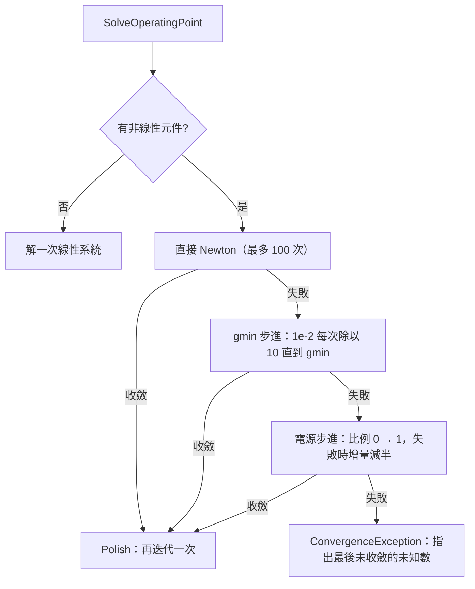
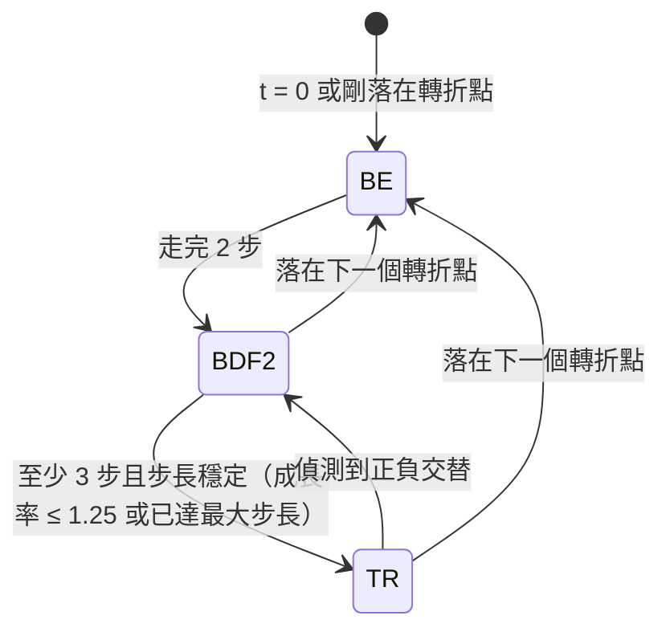

# 08 核心演算法

本專案禁止使用任何現成的數值或電路模擬套件，所以下列演算法全部自己實作。依「資料流經的順序」排列：

1. 連線萃取：圖面 → 電路
2. 電路檢查
3. MNA 組裝
4. 稀疏 LU 分解與符號分解重用
5. 奇異偵測（兩道防線）
6. Newton 與收斂策略
7. 暫態積分與步長控制
8. 最小最大抽樣金字塔
9. 量測與相位展開

---

## 1. 連線萃取

**問題**：把圖面上的元件、導線、標籤、接地，轉成「哪些接腳屬於同一個節點」。例如兩條導線十字交叉時不相連，但 T 字相接時要相連。

**輸入**：`SchematicDocument`。**輸出**：`ExtractionResult`，內容包括：

- `Circuit`。
- 每個接腳所屬的網路。
- 接點座標（只用來顯示）。
- 未連接接腳、參數錯誤、名稱重複等問題。

**步驟**（`src/CircuitBench.Schematic/Connectivity/ConnectivityExtractor.cs`）：

1. 以**格點座標**為節點建 union-find。所有「端子」都加進去：元件接腳、導線兩端、標籤、接地。
2. 每條導線的兩端 union。
3. 對每個端子，檢查它是否**嚴格落在**某條導線的中段（`GridMath.IsStrictlyInside`，不含端點）。是的話與該導線 union，並記一個接點。這一步實作了「T 字自動接點」與「接腳碰到導線中段也相連」。
4. 兩條導線只是內部交叉時，交點不是任何一方的端子，所以第 3 步不會處理到它們，自然不相連。
5. 同名標籤（不分大小寫）union；所有接地 union。
6. 命名：
   - 接地所在的集合命名為 `0`。
   - 有標籤的集合用標籤名稱。
   - 其餘集合自動命名為 `N$1`、`N$2`…，並跳過已被使用者占用的名稱。
7. 只連到一個接腳的網路，就是未連接的接腳。

**複雜度**：第 3 步是「端子數 × 導線數」的雙迴圈，O(T·W)。教學規模的電路（幾十到幾百個元素）完全不是瓶頸。🔍 推斷：若要支援上千條導線，可以先把導線依 x、y 座標建索引，只檢查同一列或同一行的導線。

**邊界條件**：

- 長度為 0 的導線（`IsValid` 為 false）會被排除。
- 標籤名稱前後空白會先 trim。
- 標籤名稱是 `"0"` 時併入接地。

## 2. 電路檢查

**問題**：分析前找出學生最常犯的接線錯誤，並指出元件與節點。

實作在 `src/CircuitBench.Core/Validation/CircuitValidator.cs`，兩個主要檢查都用 union-find：

| 檢查 | 做法 |
|---|---|
| 浮接節點 | 只用「直流路徑」的元件建邊：R、L、V、E 的輸出端、二極體、開關（📄 需求規格定義）。不在節點 0 的集合中的節點，就是浮接節點 |
| 電壓源與電感迴路 | 只用 V、E 的輸出端、L 建邊。加入某條邊時，兩端已經在同一集合，就代表形成迴路。接著在已加入的邊所構成的森林上做 BFS（`FindPath`），找出迴路經過的所有元件 |

```csharp
// src/CircuitBench.Core/Validation/CircuitValidator.cs（CheckVoltageLoops 節錄）
if (!uf.Union(a, b))
{
    var path = FindPath(adjacency, a, b) ?? [];        // 森林中 a 到 b 的唯一路徑
    var loop = path.Append(c.Name).ToImmutableArray(); // 加上造成迴路的這條邊
    issues.Add(new CircuitIssue(IssueCode.VoltageSourceInductorLoop, /* 中文訊息 */, loop, /* 節點 */));
    continue;                                          // 不加入森林，維持「森林」性質
}
adjacency[a].Add((b, c));
adjacency[b].Add((a, c));
```

值得學的地方：**只有成功 union 的邊才加入鄰接表**，所以鄰接表永遠是一片森林，兩點之間的路徑唯一，BFS 找到的就是那個迴路。如果把所有邊都加入，就得處理多條路徑的問題。

## 3. MNA 組裝

**未知數**（`src/CircuitBench.Core/Mna/MnaLayout.cs`）：

- 先排所有非接地節點的電壓。
- 再排 V、E、L 的支路電流。
- 接地節點的索引是 −1，蓋印時自動略過。

**蓋印**：

| 元件 | 方式 |
|---|---|
| R | G = 1/R 蓋在 (p,p)、(q,q)，−G 蓋在 (p,q)、(q,p) |
| I | 只改右側向量 |
| G（VCCS） | gm 蓋在輸出列、控制欄 |
| V、E | 關聯矩陣 ±1 蓋在 (p,k)、(k,p)、(q,k)、(k,q)；E 另在 k 列加上 −gain × 控制電壓 |
| L | 直流時 v(p) − v(q) = 0（短路）；暫態時 k 列加上 −L·A0 的對角，也就是 v = L·di/dt 的伴隨模型 |
| C | 直流時開路；暫態時為等效電導加等效電流源 |
| 二極體 | 在目前迭代值線性化成 gd 與 Ieq，並聯 gmin |
| 開關 | 電導隨時間在 1/Ron 與 1/Roff 之間切換 |

**固定結構**：每個節點的對角一定預留（給 gmin 步進用），元件只在 `Register` 登記一次。所以直流、暫態、交流整個過程中，矩陣**結構從不改變**。這是下一節「符號分解重用」的前提。

## 4. 稀疏 LU 分解與符號分解重用

**問題**：解 Ax = b，A 是稀疏矩陣。以 100×100 電阻網格為例，有 1 萬個未知數、約 5 萬個非零元素。暫態分析的每一步、Newton 的每一次迭代都要解一次，但矩陣結構一直相同。

**實作**：`src/CircuitBench.Core/LinearAlgebra/SparseLu.cs`，泛型 `SparseLu<T>`，T 為 `double` 或 `Complex`。分解形式為 P·A·Q = L·U。

### 4.1 欄排序：最小度（Minimum Degree）

`MinimumDegreeOrdering.Compute()` 在 A+Aᵀ 的結構上，每次消去度數最小的節點，並把它的鄰居連成團（明確建出消去圖）。度數佇列用 `SortedSet<(Degree, Node)>`。

- 排序**只在第一次 `Factor` 時計算**，結果存在 `_colOrder`。
- 效果：100×100 網格填入後約 39 萬個非零元素。不排序的話，帶狀填入會接近 1 萬 × 200 = 200 萬個。
- 🔍 替代方案：AMD（Approximate Minimum Degree）用商圖（quotient graph）避免明確建團，速度快很多。此處選擇明確消去圖，推測是因為實作簡單，而且在題目規模下已經夠快（網格直流約 0.15–0.31 s，門檻 1 s）。

### 4.2 完整分解：左看式 Gilbert–Peierls

對第 k 步（處理原始欄 `col = _colOrder[k]`）：

```
1. 把 A(:,col) 散佈到稠密工作向量 work
2. 符號：從 A(:,col) 的非零列出發，沿已完成的 L 欄做 DFS，
   得到「這一欄會被哪些已完成步驟更新」，依拓樸順序排好
3. 數值：依拓樸順序做稀疏三角求解
     for j in topo:
         U(j,k) = work[pivotRow[j]]
         work[r] -= L(r,j) * U(j,k)   對 L 第 j 欄的每個 r
4. 選主元：在尚未成為主元的列中找最大值 best
     若對角候選 ≥ threshold × best，優先選對角（threshold 預設 0.1）
5. L(:,k) = 其餘候選 / 主元
```

- **為什麼左看（left-looking）**：每一欄只需要讀取已完成的 L，記憶體存取集中，而且 DFS 能精確算出需要的更新步驟，運算量與實際的非零元素數成正比，不是 O(n²)。
- **為什麼門檻式主元**：只要求主元「夠大」，不要求「最大」。這樣可以盡量選對角，維持排序帶來的稀疏性。

### 4.3 只重做數值：`Refactor`

結構不變時，第 2 步的 DFS 結果（`_uSteps[k]`，已依拓樸順序保存）與主元順序都可以沿用，只重做第 3 步的數值：

```csharp
// src/CircuitBench.Core/LinearAlgebra/SparseLu.cs（Refactor 節錄）
for (var t = 0; t < uSteps.Count; t++)        // 沿用上次的拓樸順序，不再 DFS
{
    var j = uSteps[t];
    var xj = _work[_pivotRow[j]];
    uVals[t] = xj;
    for (var e = 0; e < rows.Count; e++) _work[rows[e]] -= vals[e] * xj;
}
// 主元相對同欄其他候選太小，或相對尺度接近奇異 → 退回 Factor 重新選主元
if (pivotMag == 0 || pivotMag < _pivotThreshold * maxOther || pivotMag <= SingularPivotTolerance * colScale)
{
    _fallback++;
    Factor(a, elementScale);
    return;
}
```

**為什麼需要退回**：Newton 迭代中，二極體的電導可能從 1e-12 變成 1e+1，原本選的主元在新的數值下可能變得極小，繼續沿用會放大捨入誤差。退回的次數記在 `LuStatistics.RefactorFallbacks`。

**效果**：2,000 節點 RC 梯形網路跑 10,000 步暫態時，只做數值分解的次數是 10,071 次（📄 README「效能」）。交流分析的 500 個頻率點只做一次複數的完整分解。

### 4.4 複雜度

- 完整分解：與 L、U 的非零數與更新運算量成正比。
- `Refactor`：省掉 DFS 與選主元的時間，運算量相同，但常數小很多。
- `Solve`：O(nnz(L) + nnz(U))。

## 5. 奇異偵測（兩道防線）

**問題**：審查者回報下面這個網表能通過電路檢查，卻得到 V(n1) = 3.07e15 V，沒有任何錯誤：

```
I1 0 n1 DC 1m
R1 n1 0 3k
G1 n1 0 n1 0 -0.000333333333333333
```

G1 的負轉導剛好抵消 R1 的 1/3k 電導，**抵消發生在同一個矩陣元素 (n1,n1) 內**，殘值只剩捨入誤差等級。

### 第一道防線：以「抵消前的量級」當尺度

舊的判定是「主元 ≤ ε × 該欄目前的最大值」。但這一欄的最大值就是那個殘值本身，判定永遠不會成立。

修正後，組裝時每個元件蓋印都同時記錄 `|蓋印值|` 的最大者（`StampScale.Track`，存在 `RealLoadContext.Scale`）。分解時，每欄的尺度取兩者較大者：

- 該欄所有元素**抵消前**的量級。
- 消去過程中出現過的最大更新量。

主元 ≤ 1e-13 × 尺度，就判定為奇異。

在上例中，(n1,n1) 抵消前的量級是 3.3e-4，殘值約 3.3e-19（由舊版的錯誤解反推：1 mA ÷ 3.07e15 V），比值約 1e-15 < 1e-13，判定為奇異。

### 第二道防線：求解後的條件數下界

捨入誤差也可能在多步消去中累積，讓主元剛好落在門檻上方。所以求解後再算列縮放後的條件數下界：

κ(D·A) ≥ ‖x‖∞ / maxᵢ(|bᵢ| / rᵢ)

rᵢ 是第 i 列抵消前的最大量級。直覺上，分母是「每一列單獨看時，解大概多大」，分子是實際的解。實際的解比分母大上 1e12 倍以上，就代表矩陣在放大誤差，解只剩約 3 位有效數字。

**為什麼要列縮放**：「電流灌進只經 Roff = 1 TΩ 接地的節點，得到 1e6 V」是量級懸殊但**正確**的解。不縮放的話會被誤判。以那一列自己的量級（1e-12）縮放後，|b|/r = 1e-6/1e-12 = 1e6，與解相符，比值約 1。

**驗證**：300 個隨機秩虧矩陣全部偵測到，200 個良態矩陣沒有誤報（`Property_RankDeficientMatricesAreDetected`、`Property_WellConditionedMatricesAreNotFlagged`）。

**限制**：門檻 1e12 是取捨。條件極差但還沒到這個程度的電路仍會求解，只是有效位數較少（📄 README「已知限制」）。

## 6. Newton 與收斂策略

**實作**：`src/CircuitBench.Core/Analysis/DcSolver.cs`。



**收斂條件**：每個未知數 |Δx| < reltol·max(|x|, |x_new|) + 絕對容許值（電壓用 vntol，電流用 abstol），**而且**這次迭代沒有任何二極體被 pnjlim 限制。

**pnjlim**（`DiodeDevice.Limit()`）：

- 接面電壓超過臨界值 Vcrit = nVt·ln(nVt / (√2·Is))，而且一次變化超過 2nVt 時：
  - 舊電壓為正，就把新電壓改成 v_old + nVt·ln(1 + Δv/nVt)。
  - 否則改成 nVt·ln(v_new / nVt)。
- 對數壓縮讓 exp 不會一次暴增。
- 另外，接面電壓超過 80·nVt 的部分以切線延伸，避免 `Math.Exp` 溢位。

**gmin 步進的自適應**：某一步失敗時，回到上一個成功的 gmin，並把除數開根號（10 → 3.16 → 1.78…），步伐變小再試；除數小於 1.05 就放棄。

**Polish**：Newton 是二次收斂，收斂判定時誤差已經小於容許值，再多做一次迭代，誤差會變成大約容許值的平方。這讓二極體電流與 Lambert W 解析解的誤差小於 1e-6，遠優於 reltol = 1e-3 的保證（📄 README「收斂策略」）。

**已知缺口**：在預設的迭代上限下，還沒找到「自然需要步進」的電路。測試以壓低迭代上限或 `SkipDirectNewton` 強迫走到步進路徑（📄 `docs/TEST-REPORT.md` 第 7.4 節）。

## 7. 暫態積分與步長控制

這是本專案最複雜的部分，實作在 `src/CircuitBench.Core/Analysis/TransientEngine.cs`。

### 7.1 要同時滿足的四件事

| 要求 | 對方法的限制 |
|---|---|
| LC 振盪 100 週期能量漂移 ≤ 1% | 需要不損失能量的方法：TR（梯形法）在線性 LC 時等同隱式中點法，能量守恆 |
| 理想開關切斷電感電流不得逐步正負交替 | 需要 L-stable 的方法：TR 遇到剛性模態（Roff = 1 TΩ）會交替 |
| 轉折點時間誤差 ≤ 1e-15 s | 步長必須截短，並讓時間「剛好」等於轉折點 |
| RLC 頻率與衰減率誤差 ≤ 0.2% | LTE 控制不夠，需要額外的步長上限 |

### 7.2 積分方法的切換



- **為什麼先 BE 再 BDF2**：轉折點之後沒有可用的歷史（前一段的導數已經不連續），BDF2 需要兩個歷史點，所以先用只需要一點的 BE 走兩步。
- **非轉折點的剛性**：例如飛輪二極體在電流降到 0 時截止，節點瞬間變成極高阻抗。這種情況沒有轉折點可以預先切換方法，所以加了一道檢查：
  1. TR 的這一步讓某個未知數**反向**時，用 BDF2 重算同一步。
  2. 在反向的未知數上，兩者相差超過容許值的 10 倍，就判定為 TR 振盪，改用 BDF2 的結果。
  3. 正常的極值處（例如 LC 的波峰），TR 與 BDF2 只差 LTE 等級，所以保留 TR 的結果，不損失能量。

### 7.3 LTE 估計

以狀態量（電容電壓、電感電流，由 `Device.CollectStates()` 收集）的除差估計導數：

| 方法 | LTE | 估計方式 |
|---|---|---|
| BE | h²x″/2 | 二階除差 DD2，x″ ≈ 2·DD2 |
| TR | h³x‴/12 | 三階除差 DD3，x‴ ≈ 6·DD3 |
| BDF2 | ≈ 2h³x‴/9 | 同上 |

容許值 = trtol·(reltol·局部尺度 + vntol 或 abstol)，局部尺度取最近幾點的最大絕對值。

- 誤差比 r > 1：拒絕，新步長 h·max(0.25, 0.9·r^(−1/(p+1)))，p 是方法的階數。
- 接受時：步長最多放大到 2 倍。

### 7.4 三道額外的步長上限

LTE 控制的是**每一步的局部誤差**，管不到兩件事：

- 長時間累積的相位誤差：TR 的頻率誤差約 (ωh)²/12。
- 沒有狀態量的電路：純電阻的半波整流 LTE 恆為 0。

所以審查回饋後加了三道上限：

1. **SIN 電源**：最大步長 ≤ 週期 / 50（`TransientEngine.SinePointsPerPeriod`）。週期由 `Device.DrivingPeriod` 提供。
2. **自由振盪**：`OscillationTracker` 追蹤每個狀態量的相鄰極值。
   - 兩個極值的間隔就是半週期估計值。擺動超過容許值的 100 倍時，視為振盪。
   - 步長上限設為「估計週期 / 100」。要達到 0.2%，需要 (ωh)²/4 ≤ 0.002，也就是每週期約 100 步。
   - 超過 4 個半週期沒有新的極值就解除，振盪衰減後不再浪費點數。
3. **折線內插誤差**：結果以折線顯示與量測，所以要求每段折線與真實曲線的最大差距 ≈ h²|x″|/8 不超過容許值。這一道檢查**所有未知數**，不只是狀態量，所以涵蓋二極體轉折處的急彎。

| 預設設定下（📄 `docs/TEST-REPORT.md` 7.2） | 修改前 | 修改後 |
|---|---|---|
| RLC 頻率誤差 | 0.457% | 0.033% |
| RLC 衰減率誤差 | 1.368% | 0.098% |
| 半波整流折線誤差 | 1.31% 峰值 | 0.08% 峰值 |
| 半波整流點數（2 週期） | 60 | 約 760 |

### 7.5 轉折點

1. 所有元件的 `Breakpoints(0, stop)` 收集成排序、去重的陣列，最後加上停止時間。
2. 下一步會跨過轉折點時，把 `tNew` **直接設成轉折點的值本身**，而不是 `t + h`。所以時間誤差為 0。
3. 剩下的距離小於 0.25h 時，把剩下的距離平分成兩步，避免留下極短的步長。
4. 落在轉折點的那一步以 `Math.BitDecrement(tNew)` 求電源值（左極限）。
5. 落在轉折點之後：清空 LTE 歷史、回到 BE，下一步的步長約取「目前步長」與「到下一個轉折點的距離」兩者較小者的 1/10。

**為什麼 `tNew = bp` 而不是 `t + (bp - t)`**：浮點數運算 `t + (bp − t)` 不保證等於 `bp`。直接賦值才能保證驗收標準 10 的「時間誤差 ≤ 1e-15 s」，實際上誤差是 0。

## 8. 最小最大抽樣金字塔

**問題**：100 萬個點、1,920 像素寬。每次縮放或平移都要知道每個像素欄內的最小值與最大值，才能畫出不遺漏尖峰的波形。

**資料結構**（`src/CircuitBench.Core/Sampling/MinMaxPyramid.cs`）：

- 第 0 層是原始資料。
- 第 k 層每個元素是第 k−1 層相鄰兩個元素的 min 與 max。
- 每條訊號只在載入時建一次，空間約 2N。

**區間查詢 `RangeMinMax(lo, hi)`**：由下往上的線段樹查詢。

```csharp
// src/CircuitBench.Core/Sampling/MinMaxPyramid.cs
while (lo < hi)
{
    if ((lo & 1) == 1) { mn = Math.Min(mn, _min[level][lo]); mx = Math.Max(mx, _max[level][lo]); lo++; }
    if ((hi & 1) == 1) { hi--; mn = Math.Min(mn, _min[level][hi]); mx = Math.Max(mx, _max[level][hi]); }
    lo >>= 1; hi >>= 1; level++;
}
```

左端是奇數時，它不是上一層某個元素的左半，只能單獨取用；右端同理。兩端各自處理完後，就能整批上移一層。每層最多取兩個元素，所以是 O(log N)。

**抽樣 `Decimate`**：

1. 以二分搜尋找出每個像素欄的索引邊界。
2. 每欄做一次區間查詢。
3. 總計 O(W·log N)，與 N 幾乎無關。

**正確性**：每欄的結果等於該欄所有點的真實 min 與 max，所以單一取樣點的尖峰在任何縮放都看得到（`SingleSampleSpikeIsNeverLostAtAnyZoom`）。性質測試以 `DecimateBruteForce` 對照，邊界定義完全相同。

**替代做法**：

- 每 k 點取一點的等距抽樣：會遺漏尖峰，違反需求。
- LTTB（Largest-Triangle-Three-Buckets）：視覺上漂亮，但不保證保留極值。

## 9. 量測與相位展開

**平均值與 RMS**（`src/CircuitBench.Core/Measurement/Measurements.cs`）：把資料視為**分段線性**，逐段做精確積分。

- 平均：∫v dt，每段 h(a + b)/2，即梯形積分。
- RMS：∫v² dt，每段 h(a² + ab + b²)/3。這是線性函數平方的精確積分，不是梯形近似。

所以在暫態的**非均勻**時間點上也正確，不需要重新取樣。

**頻率**：

1. 減去平均值。
2. 找上升零交越，交越時間以線性內插求得。
3. 頻率 = (交越數 − 1) / (最後交越 − 第一個交越)。

**相位展開**（`src/CircuitBench.Core/Bode/BodeMath.cs`）：

- 相鄰兩點的相位差若超過 ±180°，就以 360° 的整數倍修正累積偏移 `offset -= 360 * Math.Round(diff / 360)`。
- 這樣二階以上的濾波器相位能連續走到 −180° 以下，不會在 ±180° 處折返跳動。
