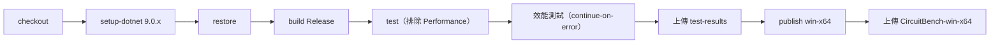

# 10 建置與發佈

本專案是離線桌面程式，沒有伺服器部署。本章說明如何在新機器上建置、執行、發佈，以及 CI 的流程。

## 環境需求

| 項目 | 版本 | 備註 |
|---|---|---|
| 作業系統 | Windows 10／11 | 📄 需求規格只以 Windows 為目標；預設字型 Microsoft JhengHei |
| .NET SDK | 9.0.x | 開發時使用 9.0.315 |
| Git | 任一版本 | 取得原始碼 |
| IDE（選用） | Visual Studio 2022 17.12 以上、Rider 或 VS Code + C# Dev Kit | 🔍 推斷：需要支援 .NET 9 的版本 |

不需要資料庫、外部服務或任何金鑰。

## 本機啟動

```powershell
git clone https://github.com/hn83320589/CircuitBench.git
cd CircuitBench
dotnet build -c Release
dotnet run --project src/CircuitBench.App -c Release
```

開啟範例：執行後選「開啟」，到 repo 的 `samples/` 資料夾選一個 `.cbench`，例如 `samples/04-half-wave-rectifier.cbench`。每個範例的預期結果寫在 `samples/EXPECTED.md`。

## 設定項

本專案沒有設定檔或環境變數會影響正式執行。下列環境變數只用於測試：

| 名稱 | 用途 | 範例值 | 必填 |
|---|---|---|---|
| `CIRCUITBENCH_SEED` | 只用指定的種子重跑性質測試 | `20261106` | 否 |
| `CIRCUITBENCH_SCREENSHOTS` | Headless 測試把截圖寫到這個資料夾 | `docs/images` | 否 |
| `CIRCUITBENCH_WRITE_SAMPLES` | 由 `SampleCatalog` 重新產生 `samples/` 下的檔案 | `1` | 否 |

程式執行時使用的資料夾（由 `DefaultAppPaths` 提供，見 `src/CircuitBench.App.ViewModels/Services/Services.cs`）：

| 資料夾 | 內容 |
|---|---|
| `%UserProfile%\Documents\CircuitBench\` | 對話框預設的專案檔位置 |
| `%LocalAppData%\CircuitBench\` | session.lock、`autosave.cbench` |

數值設定（reltol、vntol、abstol、gmin、Newton 上限）存在每個專案檔的 `analysis` 區段，在分析設定畫面調整。

## 發佈單一執行檔

```powershell
dotnet publish src/CircuitBench.App -c Release -r win-x64 --self-contained true -p:PublishSingleFile=true -o publish/win-x64
```

- `--self-contained true`：把 .NET 執行環境一起打包，學生的電腦不需要安裝 .NET。
- `PublishSingleFile=true`：輸出單一 `.exe`。CI 產出的 artifact 約 42 MB（📄 `docs/TEST-REPORT.md` 驗收標準 26）。

## CI 流程

`.github/workflows/ci.yml` 在 push 到 main、pull request、手動觸發時執行，runner 為 `windows-latest`：



| 階段 | 失敗時 |
|---|---|
| build | CI 變紅（`TreatWarningsAsErrors`，任何警告都算失敗） |
| test | CI 變紅；TRX 結果仍會上傳（`if: always()`） |
| 效能測試 | **不影響 CI**：GitHub runner 效能浮動大，只供參考（📄 規劃決策 D4、README「效能」） |
| publish | CI 變紅 |

README 的 CI 徽章指向這個 workflow。

## 常見問題

| 症狀 | 原因與排除 |
|---|---|
| `dotnet test` 時 TestKit 的 testhost 失敗 | TestKit 參考了 xunit，會被當成測試專案。它的 csproj 檔必須保留 `IsTestProject=false`（📄 commit `a02f782`） |
| Headless 測試在關閉視窗時當機 | 關閉前的「未儲存確認」若用真的對話框，Headless 下沒有人能按。現在確認邏輯在 `MainWindowViewModel.ConfirmCloseAsync()`，測試使用 `NullDialogs`（📄 commit `66297ca`：「關閉前的未儲存確認移到 ViewModel」） |
| 效能測試數據比 README 慢很多 | 要用 Release 組態、電源計畫設為高效能；第一次執行包含 JIT 暖機，測試已先暖機一次再量測 |
| 中文字型顯示異常 | 程式預設使用 Microsoft JhengHei，只在 Windows 上驗證過 |
